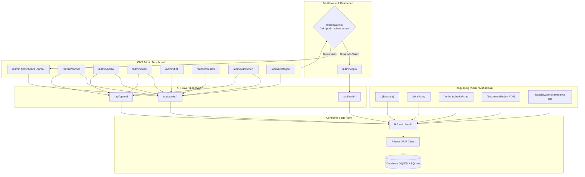

# Frontend Flow & API Contract Specification - GenBI-Hub

Dokumen ini mendefinisikan pemetaan antarmuka (*Page Route Map*), alur navigasi (*UI Navigation Flow*), serta kontrak data (*API Contracts*) antara antarmuka frontend (Next.js) dan backend API pada **GenBI-Hub CMS**.

---

## 🗺️ 1. Page Route Map & Struktur Navigasi

### A. Rute Publik (Public Web Portal)
| URL Path | Deskripsi Halaman | Data Source / Controller |
| :--- | :--- | :--- |
| `/` | Halaman Beranda (Hero Carousel, Profil Singkat, Highlight Proker, Berita Terbaru, Prestasi) | `bannerController`, `articleController`, `achievementController`, `statsController` |
| `/profil` | Profil Lengkap GenBI UPNVJT, Visi & Misi, Sambutan Pembina & BPH | `bphController` |
| `/divisi/[slug]` | Detail Divisi (Deskripsi, Program Kerja, dan Daftar Anggota Divisi) | `divisionController`, `workProgramController` |
| `/berita` | Portal Berita, Artikel Opini, dan Informasi Kebanksentralan (CBP Rupiah & QRIS) | `articleController`, `categoryController` |
| `/berita/[slug]` | Detail Baca Berita / Artikel Komunitas | `articleController.getBySlug` |
| `/prestasi` | Showcase Hall of Fame & Penghargaan Anggota/Organisasi | `achievementController` |
| `/dokumen` | Bank Data Unduhan (SK Beasiswa, Template LPJ, Proposal, Panduan) | `documentController` |
| `/beasiswa` | Informasi & Alur Seleksi Beasiswa Bank Indonesia (Syarat, Timeline, Link Form) | `documentController`, `articleController` |

### B. Rute CMS Admin Dashboard (Protected via Middleware)
| URL Path | Deskripsi Modul Admin | Komponen / Aksi |
| :--- | :--- | :--- |
| `/admin/login` | Form Autentikasi Admin | Login Form, Cookie JWT Setter |
| `/admin` | Dashboard Ringkasan & Metrik Organisasi | Kartu Statistik, Log Aktivitas Terbaru, Quick Action |
| `/admin/banner` | Manajemen Carousel Banner Beranda | CRUD Banner (Upload Cover, Title, Link CTA, Urutan) |
| `/admin/berita` | Manajemen Publikasi Artikel & Berita | CRUD Berita (Rich Text, Kategori, Status DRAFT/PUBLISHED) |
| `/admin/bph` | Manajemen Profil BPH & Pembina | CRUD Pengurus Harian (Nama, Jabatan, Foto, Sosmed) |
| `/admin/divisi` | Manajemen Divisi & Anggota | CRUD Divisi, CRUD Anggota per Divisi (Nama, Prodi, Foto GIF) |
| `/admin/prestasi` | Manajemen Penghargaan & Lomba | CRUD Prestasi (Juara, Tingkat, Badge, Penyelenggara, Foto) |
| `/admin/dokumen` | Manajemen Arsip Dokumen PDF | CRUD Dokumen (Upload PDF, Kategori SK/LPJ/Proposal) |
| `/admin/kategori` | Master Kategori Dinamis | CRUD Master Kategori Berita & Dokumen |
| `/admin/proker` | Monitoring Program Kerja Divisi | CRUD Proker (Status, Tanggal, Anggaran, PJ Kegiatan) |

---

## 🔄 2. UI Flow Diagram



---

## 📡 3. Spesifikasi Kontrak Data API (API Contract)

### A. Autentikasi Admin
#### 1. `POST /api/auth/login`
- **Request Body**:
  ```json
  {
    "username": "admin",
    "password": "admin123"
  }
  ```
- **Response Success (200 OK)**:
  ```json
  {
    "success": true,
    "user": {
      "id": 1,
      "username": "admin",
      "name": "Administrator GenBI",
      "role": "superadmin"
    }
  }
  ```
- **Header Set-Cookie**: `genbi_admin_token=<JWT_TOKEN>; HttpOnly; Path=/; Max-Age=604800; SameSite=Lax`

#### 2. `POST /api/auth/logout`
- **Response**: Menghapus cookie `genbi_admin_token` dan me-redirect ke `/admin/login`.

---

### B. Artikel & Berita (`/api/admin/berita`)
- **`GET /api/admin/berita?status=PUBLISHED&category=Edukasi`**:
  ```json
  [
    {
      "id": 1,
      "title": "Sosialisasi CBP Rupiah di Fakultas Ilmu Komputer UPNVJT",
      "slug": "sosialisasi-cbp-rupiah-upnvjt",
      "excerpt": "GenBI UPNVJT mengadakan edukasi Cinta Bangga Paham Rupiah...",
      "content": "<p>Detail isi berita lengkap...</p>",
      "coverImage": "/uploads/berita-cbp.webp",
      "category": "Edukasi BI",
      "author": "Divisi Kominfo",
      "status": "PUBLISHED",
      "publishedAt": "2026-10-01T10:00:00.000Z"
    }
  ]
  ```
- **`POST /api/admin/berita`** (Create):
  ```json
  {
    "title": "Judul Berita",
    "excerpt": "Ringkasan artikel...",
    "content": "<p>Konten HTML...</p>",
    "coverImage": "/uploads/image.webp",
    "category": "Edukasi BI",
    "status": "PUBLISHED"
  }
  ```
- **`PUT /api/admin/berita`** (Update via body `id` & fields).
- **`DELETE /api/admin/berita?id=1`** (Delete).

---

### C. File Upload (`POST /api/upload`)
- **Content-Type**: `multipart/form-data`
- **Payload**: `file: (Binary)`
- **Response (200 OK)**:
  ```json
  {
    "success": true,
    "url": "/uploads/1728281920-foto.webp",
    "filename": "1728281920-foto.webp",
    "size": "420 KB",
    "type": "image/webp"
  }
  ```
