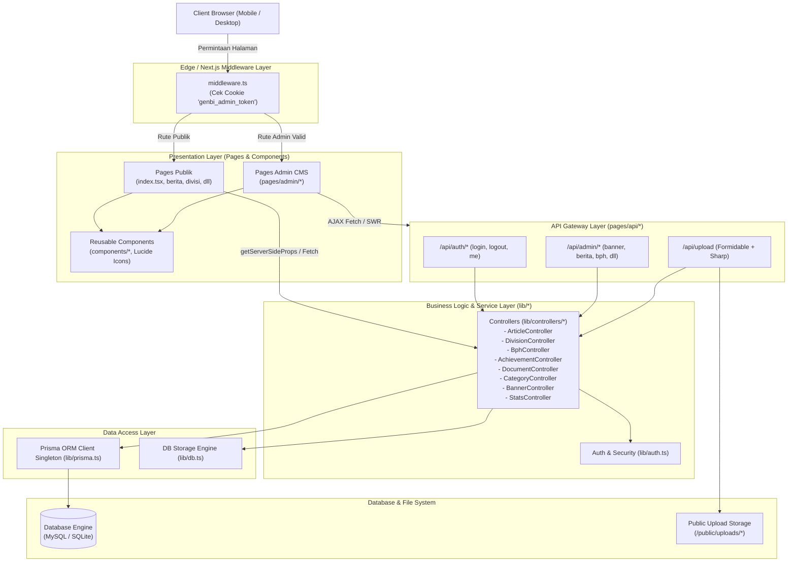
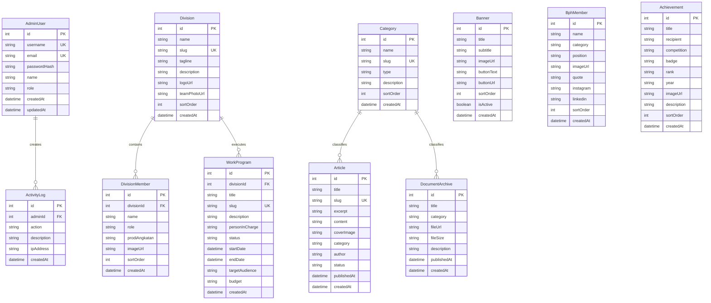

# system.md — System Architecture & Technical Specification

> **GenBI-Hub — Next-Generation Web Portal & Content Management System**  
> **Target Organisasi**: Komunitas Mahasiswa Penerima Beasiswa Bank Indonesia (GenBI UPN "Veteran" Jawa Timur)  
> **Tech Stack**: Next.js 15 (Pages Router) + React 19 + TypeScript + Prisma ORM + Tailwind CSS + Lucide Icons  

---

# 1. Arsitektur Tingkat Tinggi (High-Level Architecture)

GenBI-Hub dirancang dengan pola **Monolithic Fullstack Modern** yang memadukan server-side rendering, API handler serverless, lapisan controller terstruktur, dan ORM type-safe:

---

# 2. Skema Basis Data & Relasi Entitas (Database ERD)

---

# 3. Arsitektur Keamanan & Autentikasi

### A. Alur Autentikasi JWT Cookie
1. **Login Request**: Admin mengirim kredensial (`username` + `password`) ke `POST /api/auth/login`.
2. **Password Verification**: `auth.controller.ts` memverifikasi hash password menggunakan `bcrypt.compareSync()`.
3. **Token Issuance**: Server membuat JSON Web Token (JWT) yang memuat payload `{ id, username, name, role }` dengan masa berlaku 7 hari.
4. **HttpOnly Cookie**: Token dikirim ke browser dalam cookie berlabel `genbi_admin_token` dengan flag `HttpOnly`, `SameSite=Lax`, dan `Path=/`.
5. **Route Protection**: `middleware.ts` memeriksa keberadaan cookie pada setiap request ke `/admin/*` (kecuali `/admin/login`).

### B. Audit Trail / Activity Logger
Setiap mutasi data penting (tambah berita, ubah susunan BPH, unggah dokumen) secara otomatis memanggil `activityLog.create()` untuk mencatat nama admin, jenis tindakan, dan deskripsi perubahan.

---

# 4. Arsitektur File Upload & Media Storage

- **Parser**: Modul `formidable` menerima upload berkas `multipart/form-data`.
- **Image Optimization**: Berkas gambar diproses menggunakan pustaka `sharp` untuk:
  - Konversi format ke `WebP` (ukuran lebih ringan hingga 70% tanpa mengurangi ketajaman).
  - Pembatasan dimensi maksimum (maksimal lebar 1920px untuk banner, 800px untuk foto anggota).
- **Directory Sanitization**: Berkas disimpan di `/public/uploads/` dengan penamaan berbasis timestamp acak untuk mencegah tabrakan nama file (*collision*).

---

# 5. Pola Desain Controller (`lib/controllers/*`)

Seluruh API route diwajibkan menerapkan pola **Single Responsibility Controller**:
* **Input Validation**: Memvalidasi field wajib dan tipe data sebelum masuk ke database.
* **Auto Slug Generator**: Menghasilkan slug URL yang SEO-friendly dan unik secara otomatis.
* **Database Query**: Melakukan pemanggilan operasi CRUD terisolasi melalui Prisma ORM.
* **Error Propagation**: Menghasilkan error message berbahasa Indonesia yang jelas untuk ditangkap oleh frontend.
